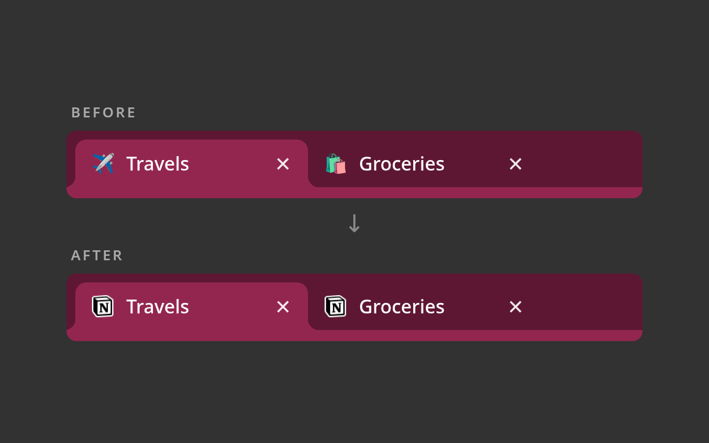

# Notion Static Favicon

[](https://github.com/platforges/notion-static-favicon/actions/workflows/ci.yml)

Chrome extension that prevents Notion's favicon from changing to match the current page. Once it's
installed, the tab icon always stays the Notion logo, which makes the tab easier to find when you
have a lot of other things open.

To temporarily restore the default behavior, disable the extension and refresh the Notion page.



## Installation

Install it from the Chrome Web Store: _link coming soon_.

Or load it unpacked: run `npm ci && npm run build`, open `chrome://extensions`, enable
**Developer mode**, click **Load unpacked**, and select the `dist/extension/` folder.

## Development

Requires Node 26 (see `.nvmrc`). Every build and test step is an npm script, and CI runs the same
scripts.

| Command               | What it does                                                                  |
| --------------------- | ----------------------------------------------------------------------------- |
| `npm run build`       | Bundle `src/` with esbuild into `dist/extension/` (version from package.json) |
| `npm run watch`       | Rebuild on change                                                             |
| `npm run typecheck`   | `tsc --noEmit`                                                                |
| `npm run lint`        | ESLint + Prettier check (`npm run format` to fix)                             |
| `npm test`            | Vitest unit tests (jsdom)                                                     |
| `npm run check`       | All of the above; this is what CI runs                                        |
| `npm run zip`         | Build and pack `dist/notion-static-favicon-<version>.zip`                     |
| `npm run publish:cws` | Upload and publish the zip to the Chrome Web Store (needs env vars below)     |

Layout: `src/pin-favicon.ts` holds the logic, `src/content.ts` is the content-script entry,
`src/manifest.json` is the manifest template, and `public/` has static files copied into `dist/extension/`
as-is (the bundled favicon and the extension icons). The 512px icon master is in `assets/`.

## Releasing

Pushing a `v*` tag runs [`.github/workflows/release.yml`](.github/workflows/release.yml). It
checks that the tag matches `package.json`, runs `npm run check`, packs the zip, uploads and
publishes it to the Chrome Web Store, and then creates a GitHub Release with the zip attached.

```sh
npm version patch   # or minor / major: bumps package.json, commits, tags
git push --follow-tags
```

### One-time setup

1. Register a [Chrome Web Store developer account](https://chrome.google.com/webstore/devconsole).
2. Create the listing manually the first time: run `npm run zip` and upload the zip in the
   developer dashboard. Then fill in the store listing, privacy practices, and screenshots. This
   gives you the **extension ID**. Your **publisher ID** is shown in the dashboard's account
   settings.
3. Create Google API OAuth credentials (client ID, client secret, refresh token) by following the
   [chrome-webstore-upload-keys guide](https://github.com/fregante/chrome-webstore-upload-keys).
4. In the GitHub repo, go to **Settings → Environments**, create an environment named
   `chrome-web-store` (optionally with required reviewers), and add these secrets: `EXTENSION_ID`,
   `PUBLISHER_ID`, `CLIENT_ID`, `CLIENT_SECRET`, and `REFRESH_TOKEN`.

Every store submission still goes through Google's review before it's live.

## Credits

Forked from [leothorp/notion-favicon-fixer](https://github.com/leothorp/notion-favicon-fixer).
